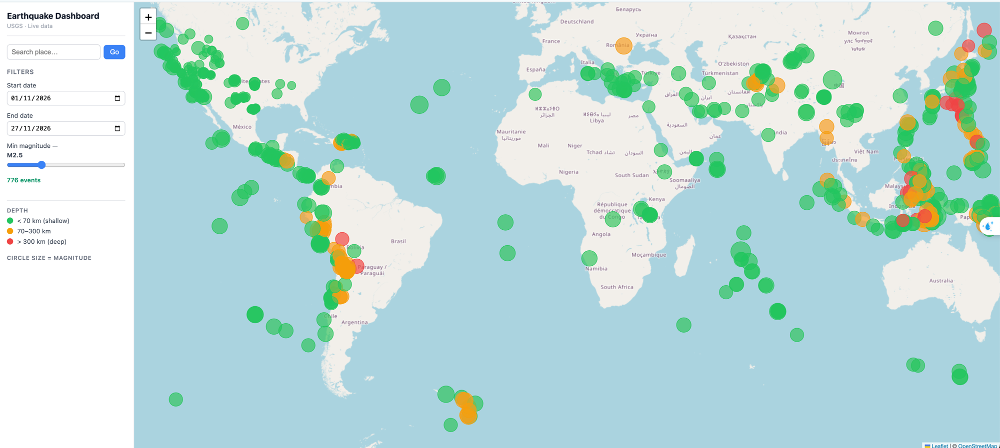

# Earthquake Dashboard

A full-stack web application that fetches real-time earthquake data from the USGS and displays it on an interactive world map. Filter by date range, magnitude, and area — just pan and zoom the map.



> Live data from USGS · 776 events shown · circles sized by magnitude · coloured by depth

---

## What it looks like

The sidebar on the left lets you search for a place, set a date range, and slide the minimum magnitude. The map updates automatically as you pan or zoom — the visible viewport is the spatial filter. Each circle on the map is one earthquake:

| Colour | Depth |
|---|---|
| Green | < 70 km (shallow) |
| Amber | 70 – 300 km |
| Red | > 300 km (deep) |

Circle size scales with magnitude.

---

## Prerequisites

| Tool | Minimum version |
|---|---|
| Node.js | 20 LTS |
| npm | 10 |

No API keys required. The app uses the free USGS FDSN Event API and OpenStreetMap tiles.

---

## Installation

```bash
# 1. Clone the repository
git clone <repo-url>
cd usgs-earthquake-dashboard

# 2. Install all dependencies (backend + frontend in one command)
npm install
```

That's it. The root `package.json` uses npm workspaces so a single `npm install` installs everything.

---

## Running in development

```bash
npm run dev
```

This starts both servers concurrently:

| Server | URL |
|---|---|
| Backend (NestJS) | http://localhost:3000 |
| Frontend (Vite) | http://localhost:5173 |

Open **http://localhost:5173** in your browser. The map loads immediately with the last 7 days of M 2.5+ earthquakes worldwide.

> The backend rebuilds automatically on file save (NestJS watch mode).  
> The frontend uses Vite HMR — changes appear instantly without a full reload.

---

## Running each server separately

```bash
# Backend only
npm run start:dev --workspace=backend

# Frontend only
npm run dev --workspace=frontend
```

---

## Building for production

```bash
npm run build
```

Outputs:
- `backend/dist/` — compiled NestJS app
- `frontend/dist/` — static Vite bundle

To start the production backend:

```bash
node backend/dist/main.js
```

Serve `frontend/dist/` with any static file server (nginx, Caddy, etc.) and proxy `/api` to `http://localhost:3000`.

---

## Running tests

```bash
# Backend unit tests
npm test --workspace=backend

# Frontend unit tests
npm test --workspace=frontend

# Backend end-to-end tests (requires network — hits live USGS API)
npm run test:e2e --workspace=backend
```

---

## Project structure

```
usgs-earthquake-dashboard/
├── backend/                  # NestJS API (port 3000)
│   └── src/
│       ├── main.ts
│       ├── app.module.ts
│       └── earthquakes/
│           ├── earthquakes.controller.ts
│           ├── earthquakes.service.ts
│           └── dto/
└── frontend/                 # React + Vite (port 5173)
    └── src/
        ├── App.tsx
        ├── api/earthquakes.ts
        ├── hooks/
        │   ├── useEarthquakes.ts
        │   └── useGeocoder.ts
        └── components/
            ├── MapView.tsx
            ├── FilterPanel.tsx
            └── SearchBar.tsx
```

---

## How it works

1. **Spatial filter** — the map viewport is the query area. Every pan or zoom sends the visible bounds to the backend (debounced 500 ms).
2. **Backend proxy** — the NestJS service normalises coordinates (antimeridian wrap, out-of-range values from Leaflet) then forwards the query to the USGS FDSN Event API.
3. **20,000-event guard** — before fetching results the backend calls the USGS `count` endpoint. If the count exceeds 20,000 it returns HTTP 422 and the frontend shows *"Too many events — zoom in or raise magnitude."*
4. **Place search** — the search bar geocodes a place name via Nominatim (free, no API key) and flies the map to those coordinates, which triggers a fresh query for the new viewport.

---

## API endpoints

```
GET /earthquakes?starttime=&endtime=&minmagnitude=&[bbox]
GET /earthquakes/count?starttime=&endtime=&minmagnitude=&[bbox]
```

All parameters are query strings. `starttime` and `endtime` (ISO 8601) are required. The frontend reaches these via a Vite proxy at `/api`.
